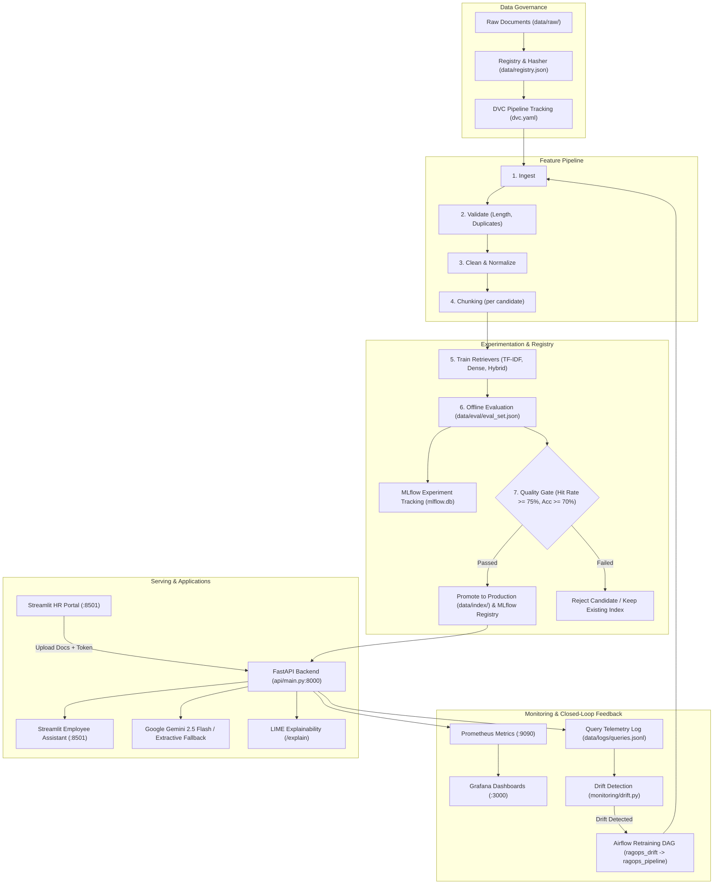

# RAGOps: Monitored Knowledge Assistant for Enterprise Support
## Comprehensive Project Analysis & System Summary

---

## 1. Executive Summary

**RAGOps** is an enterprise-grade, observable Retrieval-Augmented Generation (RAG) assistant tailored for internal enterprise support (HR, IT, Finance, and Operations). 

The system solves two distinct enterprise personas:
1. **HR / Operations Admin**: Uploads, updates, versions, and audits internal policy documents; triggers automated validation, indexing, and quality-gated model promotion.
2. **Employee User**: Inquires about internal company policies through a conversational interface, receiving grounded answers with cited sources, or explicit refusals (*"I could not find this in the company documents"*) when questions fall outside corporate documentation.

The architecture strictly adheres to modern **MLOps** standards: data and prompt versioning, automated multi-candidate experiment tracking, automated evaluation against hard quality gates, RESTful deployment, containerization, real-time telemetry (Prometheus & Grafana), LIME-based explainability, and closed-loop data drift detection with automated retraining triggers.

---

## 2. System Architecture & Workflow

The project is structured according to an end-to-end MLOps lifecycle:



---

## 3. Directory Layout & Key Artifacts

```
rag-ops/
├── .github/workflows/ci.yml         # GitHub Actions CI (lint, quality gate, unit/API tests, Docker)
├── airflow/dags/ragops_dag.py       # Airflow DAGs (Pipeline execution + hourly drift monitor)
├── api/
│   ├── __init__.py
│   └── main.py                      # FastAPI app (/ask, /explain, /health, /feedback, /drift, /admin/*)
├── cloud/                           # Cloud extensions (AWS S3 sync, SageMaker training, teardown)
│   ├── s3_sync.py
│   ├── sagemaker_entry.py
│   ├── sagemaker_train.py
│   └── teardown.py
├── configs/
│   ├── config.yaml                  # Global parameters (paths, experiments, thresholds, drift specs)
│   └── prompts.yaml                 # Versioned system prompt templates (v1, v2 active)
├── data/
│   ├── raw/                         # Source documents (.md, .txt, .pdf)
│   ├── eval/eval_set.json           # Ground-truth evaluation dataset (in-scope + out-of-scope)
│   ├── registry.json                # Master document version catalog (SHA-256 + version counters)
│   ├── index/                       # Live production index served by the API
│   ├── candidates/                  # Evaluated candidate indexes (baseline_tfidf, dense_bge, hybrid)
│   ├── processed/                   # Intermediate pipeline artifacts (docs_clean, chunks, eval rows)
│   ├── logs/queries.jsonl           # Anonymized telemetry logs for live query drift analysis
│   └── metrics.json                 # Published evaluation metrics of the winning production model
├── docs/
│   ├── data_card.md                 # Documentation of dataset lineage, format, and governance
│   └── model_card.md                # Model specifications, performance metrics, and limitations
├── frontend/                        # Streamlit web application
│   ├── Employee_Assistant.py        # Employee conversational interface with citations & LIME
│   └── pages/HR_Portal.py           # HR admin portal with token authentication & pipeline triggers
├── monitoring/
│   ├── metrics.py                   # Prometheus counters, gauges, and latency histograms
│   ├── drift.py                     # Sliding window query drift detector against baseline
│   ├── prometheus.yml               # Prometheus scrape configuration
│   └── grafana/                     # Provisioning configs and pre-configured JSON dashboard
├── src/ragops/                      # Core business logic package
│   ├── __init__.py
│   ├── config.py                    # YAML configuration and root path resolution
│   ├── documents.py                 # File reading, text cleaning, chunking, and registry versioning
│   ├── evaluation.py                # Hit rate, MRR, context recall, decision accuracy evaluation
│   ├── explain.py                   # LIME text explainer for retrieval decision transparency
│   ├── generation.py                # Google Gemini LLM synthesis and lexical groundedness proxy
│   ├── index.py                     # Index serialization, persistence, and search interfaces
│   ├── pipeline.py                  # 7-stage MLOps pipeline runner (CLI & programmatic)
│   ├── retrievers.py                # TF-IDF, FastEmbed Dense, and Hybrid implementations
│   ├── service.py                   # High-concurrency thread-safe RAG runtime engine
│   └── utils.py                     # Deterministic seed management and JSON I/O helpers
├── tests/                           # Pytest test suite
│   ├── conftest.py
│   ├── test_api.py                  # FastAPI route and integration testing
│   ├── test_pipeline_and_prediction.py # End-to-end pipeline run and quality gate assertions
│   └── test_preprocess.py           # Unit tests for text cleaning and chunking invariants
├── .dockerignore
├── .dvc/                            # DVC metadata
├── .dvcignore
├── .env.example                     # Environment template
├── .gitignore                       # Git exclusions
├── .python-version                  # Python 3.11 pinning
├── docker-compose.yml               # Multi-service stack (API, Frontend, MLflow, Prometheus, Grafana)
├── Dockerfile                       # Production container definition
├── dvc.lock                         # DVC pipeline lockfile
├── dvc.yaml                         # DVC pipeline stages and dependency graph
├── Makefile                         # Unified development shortcuts
├── mlflow.db                        # SQLite database for MLflow experiment tracking
├── pyproject.toml                   # Project tool configuration (Ruff, pytest)
├── README.md                        # Project landing page and overview
├── requirements.txt                 # Core dependencies
├── requirements-dev.txt             # Development, testing, and DVC dependencies
├── requirements-ui.txt              # Frontend Streamlit dependencies
├── setup.md                         # Quickstart setup instructions (Windows, Linux, macOS)
└── summary.md                       # This architectural analysis document
```

---

## 4. Pipeline Stages & Technical Deep Dive

The pipeline (`python -m ragops.pipeline`) enforces a 7-stage sequential execution:

| Step | Function | Description | Output Artifact |
| :--- | :--- | :--- | :--- |
| **1. Ingest** | `ingest(cfg)` | Scans `data/raw/` for supported files (`.md`, `.txt`, `.pdf`), extracts text, and registers cryptographic SHA-256 hashes. | `data/processed/docs_raw.json`, updates `data/registry.json` |
| **2. Validate** | `validate(cfg)` | Validates that files contain $\ge 20$ words and catches duplicate file payloads by hash matching. | `data/processed/validation_report.json` |
| **3. Preprocess** | `preprocess(cfg)` | Strips control characters, normalizes irregular whitespace, and standardizes multi-newlines. | `data/processed/docs_clean.json` |
| **4. Feature Eng.** | `feature_engineering(cfg)` | Splits cleaned text into sliding word windows with defined overlap for each candidate experiment. | `data/processed/chunks_<name>.json` |
| **5. Train** | `train(cfg)` | Fits the retriever algorithms for all defined experiments. Seed 42 is explicitly set for reproducibility. | `data/candidates/<name>/` (`meta.json`, `chunks.json`, index binaries) |
| **6. Evaluate** | `evaluate(cfg)` | Runs all candidates against `data/eval/eval_set.json`. Logs parameters, metrics, index binaries, and config artifacts to MLflow (`ragops` experiment). | `data/processed/eval_<name>.json`, `data/processed/results.json`, MLflow Run records |
| **7. Register & Promote** | `register(cfg)` | Identifies the top candidate by `selection_score`. Checks whether it satisfies the **Quality Gate**. If passed, copies candidate to `data/index/` and assigns alias `production` in the MLflow Model Registry. | `data/index/`, `data/metrics.json`, MLflow registered model `ragops-retriever` |

---

## 5. Experimentation & Retriever Candidates

Configured in `configs/config.yaml`:

1. **`baseline_tfidf` (Baseline)**:
   - *Algorithm*: Scikit-Learn `TfidfVectorizer` (sublinear term frequency, unigram + bigram, English stop words).
   - *Chunk Size*: 60 words (overlap: 15 words).
   - *Top-k*: 3 chunks.
   - *Score Threshold (`min_score`)*: 0.10.
2. **`dense_bge` (Dense Embedding)**:
   - *Algorithm*: FastEmbed running `BAAI/bge-small-en-v1.5` dense embeddings with cosine similarity.
   - *Chunk Size*: 50 words (overlap: 10 words).
   - *Top-k*: 3 chunks.
   - *Score Threshold (`min_score`)*: 0.55.
3. **`hybrid` (Ensemble)**:
   - *Algorithm*: Convex combination $0.5 \times \text{Score}_{\text{TFIDF}} + 0.5 \times \text{Score}_{\text{Dense}}$.
   - *Chunk Size*: 50 words (overlap: 10 words).
   - *Top-k*: 3 chunks.
   - *Score Threshold (`min_score`)*: 0.35.

### Evaluation Metrics
- **Hit Rate**: Ratio of in-scope questions where the expected ground-truth document was retrieved in the top-$k$.
- **MRR (Mean Reciprocal Rank)**: Position penalty for ground-truth source retrieval rank: $\frac{1}{\text{rank}}$.
- **Context Recall**: Percentage of required ground-truth keywords present in retrieved context.
- **Decision Accuracy**: Percentage of correct binary classifications (answering in-scope queries while refusing out-of-scope queries).
- **Composite Selection Score**:
  $$\text{Selection Score} = 0.4 \cdot \text{Hit Rate} + 0.2 \cdot \text{MRR} + 0.2 \cdot \text{Context Recall} + 0.2 \cdot \text{Decision Accuracy}$$
- **Quality Gate Rule**:
  $$\text{Hit Rate} \ge 0.75 \quad \text{AND} \quad \text{Decision Accuracy} \ge 0.70$$

---

## 6. Serving Layer & Application Interfaces

### 6.1 FastAPI Backend (`api/main.py`)
- **`POST /ask`**: Accepts `{ "question": "..." }`, queries the live `Index`, computes relevance, and returns the grounded answer, sources, doc versions, top retrieval score, and latency.
- **`POST /explain`**: Returns word-level feature weights computed via **LIME**, providing auditability into why specific terms triggered retrieval.
- **`POST /feedback`**: Records employee binary feedback (`helpful: true/false`) to Prometheus counter `ragops_feedback_total`.
- **`GET /health`**: Returns index readiness status, index fingerprint, active retriever type, and list of indexed documents.
- **`GET /drift`**: Analyzes the sliding window of live queries against training reference statistics.
- **`GET /metrics`**: Exposes standard OpenMetrics/Prometheus endpoint.
- **`POST /admin/upload` & `DELETE /admin/documents/{name}`**: Protected by `X-HR-Token` header. Uploads or deletes documents in `data/raw/` and automatically triggers end-to-end pipeline rebuilding and hot reloading.

### 6.2 Streamlit User Interfaces
- **Employee Assistant (`frontend/Employee_Assistant.py`)**:
  - Conversational chat interface.
  - Expandable source citation cards showing file name, document version, and matching snippets.
  - Interactive "Why this answer?" expander rendering LIME feature importance.
  - Quick 👍 / 👎 feedback buttons connected to the `/feedback` endpoint.
- **HR Portal (`frontend/pages/HR_Portal.py`)**:
  - Secure authentication via HR Token.
  - Drag-and-drop document upload (`.pdf`, `.md`, `.txt`).
  - Active document registry dashboard displaying live versions, SHA-256 hashes, and modification dates.
  - Pipeline trigger button with live evaluation and quality gate outcome display.

---

## 7. Monitoring, Drift Detection & Closed Loop

### 7.1 Prometheus Metrics Catalog
- `ragops_requests_total{endpoint, status}`: Overall API request throughput and error counter.
- `ragops_request_duration_seconds{endpoint}`: Latency histogram per endpoint.
- `ragops_answers_total{outcome}`: Counter tracking `"answered"` vs `"no_answer"`.
- `ragops_top_retrieval_score`: Distribution histogram of top chunk retrieval similarity scores.
- `ragops_groundedness_score`: Distribution histogram of answer lexical groundedness.
- `ragops_feedback_total{sentiment}`: Counter of user thumbs-up vs thumbs-down.
- `ragops_drift_detected`: Binary gauge ($0 = \text{nominal}, 1 = \text{drifted}$).

### 7.2 Drift Detection Engine (`monitoring/drift.py`)
Every live query is anonymized and logged to `data/logs/queries.jsonl` (recording query length, top retrieval score, answered flag, groundedness, and latency—**never raw customer text**).
The drift engine evaluates a sliding window of the last $N$ queries against the reference statistics computed during training evaluation:
1. **Retrieval Score Drop**: Triggers if mean top retrieval score drops by $> 30\%$ relative to baseline.
2. **Refusal Spike**: Triggers if the rate of unanswered queries increases by $> 25\%$.
3. **Automated Retraining Loop**: The Airflow DAG `ragops_drift` checks this status hourly; if drift is detected, it automatically kicks off `ragops_pipeline` to re-ingest, re-index, and evaluate fresh content.

---

## 8. Responsible AI & Governance

- **Fairness & Bias**: Evaluated and documented in `docs/data_card.md` and `docs/model_card.md`. Since the model only answers from explicit internal corporate policies and uses exact lexical/semantic matching, demographic bias is not applicable.
- **Hallucination Prevention**: Prompts strictly instruct the model to answer ONLY from context or respond with the exact refusal phrase. In addition, the lexical groundedness metric monitors whether the synthesized text introduces unverified tokens.
- **Transparency / LIME**: Employees can verify why a particular document chunk was matched through local surrogate model explanations (`/explain`).
- **Data Lineage**: Documents are tracked via immutable SHA-256 digests in `data/registry.json`. Every API response specifies both the `prompt_version` and the `index_version`.

---

## 9. Verification & Operational Health Check

| Component | Status | Command / Verification |
| :--- | :--- | :--- |
| **Pipeline Run** | Verified | `python -m ragops.pipeline` generates clean index & passes quality gate |
| **FastAPI Backend** | Verified | `uvicorn api.main:app --port 8000` serves `/health` and `/docs` |
| **Streamlit UI** | Verified | `streamlit run frontend/Employee_Assistant.py` loads both interfaces |
| **MLflow Tracking** | Verified | SQLite backend `sqlite:///mlflow.db` logs runs, artifacts, and registered models |
| **DVC Tracking** | Verified | `dvc repro` tracks `data/raw`, `src/ragops`, `configs/config.yaml` to `data/index` |
| **Docker Compose** | Configured | Multi-container stack (API, Streamlit, MLflow, Prometheus, Grafana) |
| **CI Workflow** | Passing | `.github/workflows/ci.yml` lints with Ruff, tests pipeline quality gate, and validates Docker |

---

## 10. Summary Assessment

The **RAGOps** project is fully implemented as an enterprise-grade MLOps reference architecture. It bridges the gap between raw generative AI prototypes and production software engineering by embedding rigorous data governance, candidate experimentation, automated quality gates, observability, and closed-loop continuous improvement.

